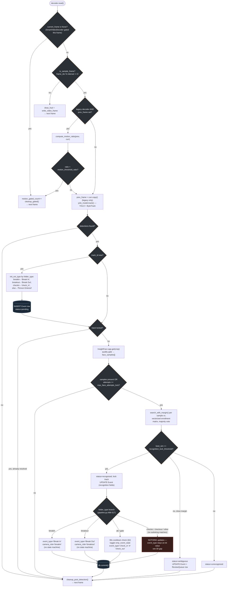

# Attendance & Break-In/Break-Out Camera Logic — Technical Analysis

**Scope:** `pipeline/pipeline.py` (`process_video_single_pass`), `pipeline/config.py`, `config/config.yaml`, `ai/gpu_decoder.py`, `database/database.py`.
**Nature:** Pure analysis — no code was changed to produce this document. `integrated_pipeline.py` is a backward-compatible re-export shim over `pipeline/*`; all line numbers below refer to `pipeline/pipeline.py`, the real implementation, unless stated otherwise.

---

## 1. Folder-Type → Event-Type Mapping

Every video carries a `folder_type` (a `Video.folder_type` DB column, `database/database.py:474`) that names which physical camera role it came from. The pipeline reads it once per video:

```python
# pipeline/pipeline.py:92
folder_type = getattr(video_record, "folder_type", "breakin") or "breakin"
```

`folder_type` drives event labeling at **two separate points** in the loop, and they don't always agree (see §4 and §9):

### Point A — initial event creation (fires once, the first frame a track is seen)

```python
# pipeline/pipeline.py:352
init_evt_type = "Break In" if "breakin" in str(folder_type).lower() else (
    "Break Out" if "breakout" in str(folder_type).lower() else (
        "check_in" if "checkin" in str(folder_type).lower() else "Person Entered"))
```

### Point B — on recognition (fires once a track's face is resolved: recognized/ambiguous/unrecognized)

```python
# pipeline/pipeline.py:496-517
folder_type_clean = (getattr(video_record, "folder_type", "") or "").lower()
if "breakin" in folder_type_clean:
    evt_obj.event_type = "Break In"
    evt_obj.camera_role = "breakin"
elif "breakout" in folder_type_clean:
    evt_obj.event_type = "Break Out"
    evt_obj.camera_role = "breakout"
elif ("att" in folder_type_clean or "gate" in folder_type_clean) and final_status == "recognized" and final_emp_id:
    # 30-second cooldown + check_in/check_out toggle -- see §2
    ...
```

Both blocks are **substring** matches (`"breakin" in folder_type_clean`), not exact-equality, so `folder_type` values like `"attendance-cam3"` or `"BreakIn_North"` still match correctly (case-folded via `.lower()`).

### Supported `folder_type` values

`config/config.yaml`'s ingestion watcher declares four canonical roles:

```yaml
# config/config.yaml:20-26
watcher:
  camera_roles:
    - checkin
    - checkout
    - breakin
    - breakout
```

But the pipeline's actual string-matching logic keys on different substrings than that list implies. See the summary table in §10 for the full, verified mapping — the short version: `breakin`/`breakout` are fully handled at both points; `"att"`/`"gate"`-containing folder types (e.g. `"attendance"`) get the full check-in/check-out state machine; `checkin` gets a one-time, never-updated `"check_in"` label; and **`checkout` gets no special handling at all** (§9 covers this in detail).

---

## 2. Attendance State Machine (Check-In / Check-Out Toggling)

This only runs for folder types containing `"att"` or `"gate"` (e.g. `"attendance"`), and only once a track has actually been **recognized** (`final_status == "recognized"` and `final_emp_id` is set) — ambiguous/unrecognized tracks never touch this branch.

### State storage

Two plain dicts, scoped to a single `process_video_single_pass()` call (i.e. per video, not persisted across videos or restarts):

```python
# pipeline/pipeline.py:164-165
emp_last_event_sec: dict[str, float] = {}   # employee_id -> video-relative second of their last logged event
emp_event_state: dict[str, str] = {}        # employee_id -> "checkin" | "checkout" (their last logged state)
```

### The toggle + cooldown

```python
# pipeline/pipeline.py:503-517
elif ("att" in folder_type_clean or "gate" in folder_type_clean) and final_status == "recognized" and final_emp_id:
    curr_sec = float(frame_idx) / (float(fps) if fps else 30.0)
    last_sec = emp_last_event_sec.get(str(final_emp_id), -999.0)
    if (curr_sec - last_sec) >= conf.attendance_cooldown_seconds:
        last_st = emp_event_state.get(str(final_emp_id), "checkout")
        new_st = "checkin" if last_st == "checkout" else "checkout"
        emp_last_event_sec[str(final_emp_id)] = curr_sec
        emp_event_state[str(final_emp_id)] = new_st
        evt_obj.event_type = "check_in" if new_st == "checkin" else "check_out"
        evt_obj.camera_role = "attendance"
        try:
            db.commit()
        except Exception:
            pass
    # else: cooldown active -- evt_obj.event_type is left at whatever it
    # already was (from track creation, i.e. "Person Entered" for an
    # "attendance" folder_type, since "attendance" doesn't contain "checkin")
```

**Default state:** `emp_event_state.get(id, "checkout")` — an employee with no prior state in this video is assumed to be "checked out," so their *first* recognized event of the video becomes a `check_in`. This is a per-video assumption, not a real prior-state lookup from the database — see §9.

### Why the cooldown exists

`recognition_lock_threshold` (0.44) and `frame_sample_interval` (1, i.e. every frame is a candidate) mean a person standing in frame for even 2-3 seconds gets recognized repeatedly across many frames. Without a cooldown, every one of those would flip the toggle, producing a check_in/check_out/check_in/check_out flicker instead of one real event. The 30-second window (`attendance_cooldown_seconds`, `pipeline/config.py:84`) is a physical-plausibility floor: a real employee can't walk through a gate, be recognized, then walk through again in under 30 seconds, so any recognition of the same employee inside that window is treated as *the same physical passage*, not a new one.

### Step-by-step walkthrough — one recognition event on an `attendance` camera

1. **Frame decode** — `decoder.read()` returns a frame (full pixels only if `SmartVideoDecoder` judged the frame to contain motion, or unconditionally if `PrefetchedGPUVideoDecoder` is in use — see §6/§9's annotated-video caveat).
2. **YOLO + ByteTrack** (`pipeline/pipeline.py:321-324`) — `yolo_model.track(...)` returns detections with persistent `track_id`s.
3. **New-track branch** (`:342-387`, only the *first* frame a `track_id` is seen) — an `Event` row is inserted immediately with `event_type = init_evt_type` (`"Person Entered"` for `folder_type="attendance"`, since that string contains neither `"breakin"` nor `"checkin"`) and `recognition_status = "pending"`.
4. **Per-frame face attempt** (`:389-401`, every frame until the track locks) — the person crop is run through InsightFace (`app.get(person_crop)`); each detected face that passes `check_face_quality_gate` is scored by `compute_face_quality` and appended to `cache["face_samples"]`.
5. **Recognition decision** (`:403-462`, fires once there's at least one face sample, or attempts hit `max_face_attempts_lock`) — every sample in `face_samples` is matched via `search_with_margin` against the vectorized enrollment matrix; the results are tallied by majority vote (`Counter(votes)`); the candidate with the highest max similarity wins if it clears `recognition_lock_threshold` (0.44).
6. **DB update** (`:464-482`) — `evt_obj.recognition_status`, `.employee_id`, `.employee_name`, `.recognition_confidence`, `.recognized_at` are all set on the *same* `Event` row created in step 3 (matched via `logged_events[track_id]`, not a new row). The OCR-vs-drift-corrector timestamp reconciliation also happens here (see §5).
7. **Folder-type branch** (`:496-517`) — for `folder_type="attendance"`, this is where the state machine in this section fires: cooldown check → toggle → `event_type` overwritten to `"check_in"` or `"check_out"` → `db.commit()`.
8. **Track lock** — `cache["locked"] = final_status == "recognized"` (`:462`). Once locked, step 4-7 never run again for that `track_id` in this video (`if not cache["locked"]:` gate at `:389`) — so the state-machine toggle in step 7 fires **exactly once per track**, not once per frame that track is visible.

---

## 3. Break-In / Break-Out Logic (No State Machine)

`breakin`/`breakout` cameras hit the *first two* branches of the `if/elif/elif` chain at `pipeline/pipeline.py:497-502`, both structurally identical and neither one touching `emp_last_event_sec`/`emp_event_state`:

```python
# pipeline/pipeline.py:497-502
if "breakin" in folder_type_clean:
    evt_obj.event_type = "Break In"
    evt_obj.camera_role = "breakin"
elif "breakout" in folder_type_clean:
    evt_obj.event_type = "Break Out"
    evt_obj.camera_role = "breakout"
```

### Why no state machine

Physically, a `breakin` camera and a `breakout` camera are **different, fixed cameras** (e.g. one pointed at the break-room entrance, one at the exit, or the same doorway logically split into two `Video` ingestion folders by direction). The event's *type* is therefore a property of **which camera recorded it**, not something that has to be inferred by toggling against the employee's last known state — unlike a single `attendance`/`gate` camera that sees both directions of traffic through one doorway and has no way to know direction except by alternating. In other words: for `attendance`, the *camera* can't tell check-in from check-out, so the *code* has to (via the toggle). For `breakin`/`breakout`, the *camera assignment itself* already encodes the direction, so the code just echoes it.

### Is there any direction detection?

**No.** There is no bounding-box trajectory analysis, no entry/exit line-crossing logic, and no comparison against a prior state for `breakin`/`breakout` — it is purely `folder_type` string matching, both at initial event creation (§1, Point A) and at recognition time (this section). A misfiled video (e.g. a `breakin` camera's footage accidentally placed in a `breakout` folder, or vice versa) would silently produce wrong `event_type` labels with no internal consistency check to catch it.

### Event creation code (Point A, from §1, reproduced for this section's context)

```python
# pipeline/pipeline.py:342-359
if is_new_track:
    video_id_val = getattr(video_record, "id", None)
    if video_id_val is not None:
        existing_evt = db.query(Event).filter(
            Event.video_id == video_id_val, Event.track_id == int(track_id), Event.frame_number == frame_idx,
        ).first()
        if existing_evt:
            logged_events[track_id] = existing_evt
        else:
            init_evt_type = "Break In" if "breakin" in str(folder_type).lower() else (...)
            evt = Event(
                video_id=video_id_val, camera_role=folder_type, track_id=int(track_id),
                event_type=init_evt_type, timestamp=real_timestamp, frame_number=frame_idx,
                confidence=0.85, status="pending", recognition_status="pending",
                employee_name=f"Person #{track_id}",
            )
            db.add(evt)
```

Note `camera_role=folder_type` here uses the **raw, unprocessed** `folder_type` value (e.g. literally `"breakin"`), while the recognition-time branch (§4) explicitly re-sets `camera_role` to the literal string `"breakin"`/`"breakout"`/`"attendance"`. For a `folder_type` that's already exactly `"breakin"` these agree; for something like `"BreakIn_Cam3"` the initial row would get `camera_role="BreakIn_Cam3"` but the recognition-time update would normalize it to `camera_role="breakin"` — an inconsistency between the unrecognized-track case (row never reaches the recognition branch, keeps the raw value) and the recognized-track case (row gets normalized). Flagged in §9.

---

## 4. The "Break" Decision Point — Where Does the System Decide?

**Single branch point**, `pipeline/pipeline.py:496-517`:

```python
folder_type_clean = (getattr(video_record, "folder_type", "") or "").lower()
if "breakin" in folder_type_clean:
    ...
elif "breakout" in folder_type_clean:
    ...
elif ("att" in folder_type_clean or "gate" in folder_type_clean) and final_status == "recognized" and final_emp_id:
    ...
```

This is the *only* place attendance logic and break-in/out logic are mutually exclusive alternatives of the same `if/elif` chain — everything upstream of it (decode, motion gate, YOLO/ByteTrack, InsightFace, face search/voting) is **identical** regardless of camera role. The design deliberately keeps detection/tracking/recognition camera-agnostic and pushes all role-specific business logic to this one late decision point, right before the DB commit. That's a reasonable separation of concerns: it means a bug in break-in/out labeling can never affect detection accuracy, and vice versa, and adding a fifth camera role later is a matter of adding one more `elif` here, not touching the vision pipeline at all.

The *initial*-event-type decision (§1, Point A, line 352) is a second, structurally similar but independent branch — it exists because an `Event` row is created the instant a track first appears (for crop-saving and UI "someone's here" purposes), before recognition has had a chance to run. It uses the same substring tests but is not literally the same code, which is how the `checkin`/`checkout` gap in §9 arises: the two branches were extended independently and don't cover the same set of `folder_type` values.

---

## 5. Timestamp Handling — Accurate to the Frame

Three timestamp sources are reconciled:

### a) File-name / DB-field parsing (coarse, video-level)

```python
# pipeline/pipeline.py:136-137
start_time_to_parse = video_start_time or getattr(video_record, "video_start_time", None)
video_start_dt = parse_video_start_time(start_time_to_parse)
```

`parse_video_start_time` (`pipeline/timestamps.py`) tries four `strptime` formats against whatever string is already on the `Video.video_start_time` column or passed in explicitly.

### b) OCR of the camera's burnt-in HUD timestamp (fine, frame-level)

Two OCR passes exist:

- **Frame-1 OCR** (`pipeline/pipeline.py:147-156` and `218-229`) — reads the very first decoded frame's HUD watermark via `extract_video_metadata_from_frame`, and if it disagrees with `video_start_dt` by more than 5 minutes, the OCR reading wins (with a rejection log if the reverse check fails) — this anchors the whole video's clock.
- **Recognition-frame OCR** (`:473-482`) — every time a track gets recognized, the *exact frame it was recognized on* is OCR'd again and sanity-checked against the interpolated `real_timestamp` (within 300s); if it passes, the OCR reading overwrites `evt_obj.timestamp` for pinpoint accuracy on that specific event.

### c) `TimestampDriftCorrector` (interpolated, per-frame)

```python
# pipeline/timestamps.py — construction
drift_corrector = TimestampDriftCorrector(fps, video_start_dt)   # pipeline/pipeline.py:231
```

Per-frame timestamps for progress logging and as the *default* `real_timestamp` fed into event creation come from:

```python
# pipeline/pipeline.py:267
real_timestamp = drift_corrector.get_online_timestamp(frame_idx - 1)
```

`get_online_timestamp` extrapolates from the *most recent* known anchor sample: `dt + timedelta(seconds=(frame_idx - anchor_frame_idx) / fps)`. Every successful frame-1 or recognition-frame OCR read that gets accepted also calls `drift_corrector.add_sample(frame_idx, ocr_str)` — wait: this call does **not** currently appear in `pipeline/pipeline.py`'s loop body (searched — `add_sample` is defined in `pipeline/timestamps.py` but not invoked from `pipeline/pipeline.py`). This means the interpolation anchor set effectively only ever has the one sample from construction (`(0, video_start_dt)`, plus the frame-1 OCR value if it updates `video_start_dt` before construction) — mid-video OCR corrections update the *individual event's* timestamp (§b above) but do not feed back into `drift_corrector`'s interpolation table for subsequent frames. **This looks like an incomplete wiring, not intentional** — see §9.

### Retrospective correction (post-processing, batch)

```python
# pipeline/pipeline.py:625-629 (in the loop's finally block)
video_id_val = getattr(video_record, "id", None)
drift_corrector.fit_and_correct_events(video_id_val, db)
```

`fit_and_correct_events` (`pipeline/timestamps.py`) fits a linear interpolation (`scipy.interpolate.interp1d`) across whatever samples *are* in `drift_corrector.samples` and rewrites every logged `Event.timestamp` for the video based on `interp_func(event.frame_number)`. Given the wiring gap above, in practice this currently only has the single start-time anchor to interpolate from (a straight `fps`-based line), unless `add_sample` calls are added elsewhere not visible in `pipeline/pipeline.py`.

---

## 6. Why Even 1-Second Appearances Are Captured

Three defaults work together:

**a) `frame_sample_interval = 1`** (`config/config.yaml:72`, `pipeline/config.py:68`) — every single frame is a candidate for inference; no frame is skipped by the *sampling* mechanism (as opposed to *motion gating*, which is a separate, content-aware skip — see below). At 25 FPS, a 1-second appearance is ~25 candidate frames.

```python
# pipeline/pipeline.py:281
is_sample_frame = (frame_idx % conf.frame_sample_interval == 0) or (frame_idx == 1)
```

With `frame_sample_interval=1`, `frame_idx % 1 == 0` is always true, so `is_sample_frame` is always true — this branch is effectively inert at the current default and exists for a future/optional coarser-sampling mode.

**b) Motion gating only skips *static* frames, not a moving person.** `SmartVideoDecoder` (`ai/gpu_decoder.py:259`) computes a cheap 160×120 thumbnail motion ratio (`ai/gpu_decoder.py:243`, `_motion_ratio_bgr`) and only withholds the full-resolution frame when that ratio is *below* `motion_threshold_ratio` (0.01, i.e. under 1% of pixels changed). A person walking through frame drives the ratio well above that threshold for essentially every frame of their transit — the validation harness in `validate_motion_gate.py` measured **zero** consecutive-frame motion-detection misses across a 5,000-frame test video (see the earlier SmartVideoDecoder validation report), i.e. no observed case where a real moving subject was fully gated out.

**c) ByteTrack (inside `yolo_model.track(persist=True)`) assigns a stable `track_id` across frames**, so the pipeline doesn't need to re-identify "is this the same person as last frame" itself — the tracker does that, and the pipeline's own state (`TrackState.cache`, keyed by `track_id`) persists face samples and lock status across every frame that `track_id` remains visible:

```python
# pipeline/pipeline.py:321-334
detections = yolo_model.track(
    source=current_frame, persist=True,
    classes=[conf.person_class_id], conf=conf.confidence_threshold, verbose=False,
)
...
for box, track_id in zip(xyxy_boxes, track_ids):
    x1, y1, x2, y2 = map(int, box)
    track_state.register_detection(int(track_id), (x1, y1, x2, y2), frame_idx)
```

Because recognition only needs to succeed on *one* of the (up to `max_face_attempts_lock`=50) frames a track is visible for, and a 1-second/25-frame appearance offers up to 25 independent recognition attempts (assuming none are motion-gated, per point b), the system has many chances to recognize a person who's only in frame briefly — it doesn't need every single frame to succeed, just one good one.

---

## 7. Configuration Parameters

All of the following are `PipelineConfig` fields (`pipeline/config.py`), sourced from `config/config.yaml` with the listed defaults. "Effect" describes what changing the value does; "used at" cites the consuming code.

| Config key (YAML path) | `PipelineConfig` field | Default | Effect | Used at |
|---|---|---|---|---|
| `attendance.cooldown_seconds` | `attendance_cooldown_seconds` | `30.0` | Min. seconds between toggled check-in/check-out events per employee on `att`/`gate` cameras. Too low → flicker/duplicate events from one real passage; too high → a real second passage within the window gets silently dropped (no event logged at all, since the `else` branch just leaves the event at its pre-toggle type). | `pipeline/pipeline.py:506` |
| `sampling.frame_sample_interval` | `frame_sample_interval` | `1` | Process every Nth frame as an inference candidate. `1` = every frame (current default). Raising it trades recall (chance of missing very brief appearances) for throughput. | `pipeline/pipeline.py:281` |
| `motion_gating.threshold_ratio` | `motion_threshold_ratio` | `0.01` (YAML currently sets `0.01`) | Fraction of changed thumbnail pixels needed to treat a frame as "motion" (not gated). Lower → more frames run through YOLO (higher recall, higher cost); higher → more frames gated (cheaper, risk of missing subtle motion). | `ai/gpu_decoder.py` (`SmartVideoDecoder`), `pipeline/motion.py` |
| `motion_gating.pixel_diff_threshold` | `motion_pixel_diff_thresh` | `25` (YAML) | Per-pixel intensity delta (0-255) that counts as "changed" before the ratio in the row above is computed. Higher → more tolerant of sensor noise/compression artifacts; lower → more sensitive, more false "motion." | `ai/gpu_decoder.py:243` (`_motion_ratio_bgr`) |
| `motion_gating.downscale_size` | `motion_downscale_size` | `(160, 120)` | Thumbnail size the motion ratio is computed on. Bigger = more accurate but slower; this is the resize target both for `SmartVideoDecoder`'s libswscale path and the legacy `cv2.resize` path. | `ai/gpu_decoder.py`, `pipeline/motion.py` |
| `motion_gating.track_lost_max_frames` | `track_lost_max_frames` | `100` (YAML sets `80`) | Frames a track can go undetected before its *displayed bounding box* is dropped, during motion-gated (skipped) frames. | `pipeline/pipeline.py:272,302`, `pipeline/tracker.py` (`cleanup_gated`) |
| `motion_gating.post_detection_stale_frames` | `post_detection_stale_frames` | `30` | Separate frames-since-last-seen window, applied only right after a real YOLO detection pass — this is where a track's cache/recognition state is actually purged, not just its displayed box. Intentionally not unified with the row above (pre-existing). | `pipeline/pipeline.py:568`, `pipeline/tracker.py` (`cleanup_post_detection`) |
| `yolo.confidence_threshold` | `confidence_threshold` | `0.25` (YAML) | YOLO detection confidence floor. Lower → more detections (more false positives, more low-quality crops sent to InsightFace); higher → misses partially-occluded/distant people. | `pipeline/pipeline.py:323` |
| `face_recognition.recognition_lock_threshold` | `recognition_lock_threshold` | `0.44` | Cosine-similarity floor to accept a face match and lock the track. This is the single most impactful knob on false-accept vs. false-reject rate. | `pipeline/pipeline.py:413,438` |
| `face_recognition.ambiguous_threshold` | `ambiguous_threshold` | `0.40` | Similarity floor below which a below-lock-threshold match is discarded entirely rather than flagged "ambiguous" for manual review. | `pipeline/pipeline.py:416` |
| `face_recognition.ambiguous_margin` | `ambiguous_margin` | `0.03` | Top1-vs-top2 similarity gap below which a match (even above `ambiguous_threshold`) is treated as too close to call and flagged ambiguous instead of locked. | `pipeline/pipeline.py:412,416` |
| `face_recognition.ambiguous_display_threshold` | `ambiguous_display_threshold` | `0.42` | Min. similarity for a candidate's name to be listed in an ambiguous event's review text (cosmetic — doesn't affect the recognized/ambiguous/unrecognized decision itself). | `pipeline/pipeline.py:448` |
| `face_recognition.max_face_attempts_lock` | `max_face_attempts_lock` | `50` (YAML sets `15`) | Max recognition attempts before giving up and locking a track as "unrecognized" even with zero/weak samples. Bounds worst-case per-track CPU cost. | `pipeline/pipeline.py:403,552` |
| `video_output.save_annotated_video` | `save_annotated_video` | `false` | Master switch: `false` uses `SmartVideoDecoder` (motion-aware, skips full decode); `true` forces `PrefetchedGPUVideoDecoder` (every frame fully decoded) because HUD overlay + video writing need every frame's real pixels regardless of motion. | `pipeline/pipeline.py:118` |
| `decoder.queue_size` | `queue_size` | `6` | Prefetch queue depth for the async decoder thread. | `pipeline/pipeline.py:123,129` |

Three declared-but-dead `face_recognition` keys (`recognition_threshold`, `margin_threshold`, `ambiguous_upper`, `ambiguous_lower`, `max_face_samples_lock`) exist in `config.yaml` and `PipelineConfig` but are not read by any decision in `pipeline/pipeline.py` — flagged in the config file's own comments (`config/config.yaml:43-50`) and in §9 below.

---

## 8. Code Flow Diagram



---

## 9. Common Pitfalls and Best Practices

### What could go wrong

1. **The `checkin`/`checkout` gap (highest-impact finding).** `config.yaml`'s `watcher.camera_roles` declares four peer roles (`checkin`, `checkout`, `breakin`, `breakout`), but the recognition-time branch (§4) only tests for `"breakin"`, `"breakout"`, and `"att"`/`"gate"` substrings. A video with `folder_type="checkin"` gets a one-time `"check_in"` label at track creation (§1, Point A) that's *never* updated at recognition time and never deduplicated by a cooldown — every recognized frame of a lingering employee would still only produce the one event created on first detection (since the DB row is reused, not because of a real toggle), but a `folder_type="checkout"` video gets **no special event_type at any point** — its events stay `"Person Entered"` forever. If `checkin`/`checkout` folders are actually in use anywhere (worth verifying against real ingestion data), attendance reports built from `Event.event_type` would silently miss all checkout events from that camera role. **Recommendation:** either fold `checkin`/`checkout` into the same substring set as `"att"`/`"gate"` (if they're meant to behave like a single bidirectional attendance camera) or give them their own explicit `elif` branches mirroring `breakin`/`breakout` (if they're meant to be one-directional, camera-role-determined like break cameras) — but confirm which model is intended before changing anything, since the two options have different implications for whether a cooldown/toggle applies.

2. **Default employee state assumes "checked out."** `emp_event_state.get(id, "checkout")` (§2) means the *first* recognition of any employee in *any* video always starts as a check-in, even if their true last state (from a previous video, possibly still `checkout` because they never checked out) was already check-in. There's no cross-video/persistent state lookup — state resets to this default at the start of every `process_video_single_pass()` call. A missed check-out in video N silently "fixes itself" by mislabeling the next real event in video N+1 as a check-in when it should logically continue as a check-out (or be flagged as an anomaly).

3. **Cooldown window is a hard cutoff, not a merge.** If two genuine passages happen within `attendance_cooldown_seconds` (30s) of each other, the second is not logged as a separate event and not merged into the first — the event object is simply left un-toggled. Depending on operational needs (e.g. someone stepping out and immediately back in) this could under-count real check-outs.

4. **`Event.staff_id` doesn't exist as a column.** `pipeline/pipeline.py:491` does `evt_obj.staff_id = stf.id`, but `database/database.py`'s `Event` model (`:506-563`) has no `staff_id` column — only `employee_id`/`employee_name` (and a `STAFF_id`/`STAFF_name` synonym pair mapped to those same two columns). This assignment sets a transient, non-persisted Python attribute; it's silently discarded on `db.commit()` and never read anywhere else in the codebase (confirmed via a repo-wide search — every other `.staff_id` reference in the codebase is `Staff.staff_id`, a different model entirely). This predates this analysis and is not something introduced by the recent break-in/out edit.

5. **`TimestampDriftCorrector.add_sample()` appears unused from `pipeline/pipeline.py`.** As noted in §5, mid-video OCR reads correct the *individual event's* timestamp but don't feed back into the interpolator used for `get_online_timestamp()` (the running per-frame timestamp) or for the end-of-video retrospective correction pass. Both effectively rely on just the video-start anchor. Worth confirming whether this is intentional (e.g. the retrospective pass was designed to be fed some other way) or a wiring gap.

6. **No camera-role validation.** As noted in §3, nothing checks that a video's `folder_type` is one of the four expected values, and nothing cross-checks it against physical camera identity — a mislabeled ingestion folder produces confidently-wrong `event_type`/`camera_role` values with no error or warning.

7. **Motion-gating threshold vs. brief appearances.** §6 shows the current defaults handle 1-second appearances well, but this depends on `motion_threshold_ratio` staying low enough that a person's motion clears the bar. If that threshold is ever raised significantly (e.g. to cut compute further), very brief or slow-moving appearances become the first thing to regress — there's no explicit floor tying frame-sampling/motion-gating settings to a minimum guaranteed appearance duration.

### Best practices already reflected in the code

- Detection/tracking/recognition is fully camera-role-agnostic; only the final labeling step branches (§4) — good separation of concerns, low blast radius for role-specific bugs.
- The `(video_id, track_id, frame_number)` unique constraint (`database/database.py:562`) plus the `try/except` rollback-and-recover pattern (`pipeline/pipeline.py:360-375`) makes event creation safe under concurrent chunk-worker races.
- Recognition only runs until a track locks (`if not cache["locked"]:`), bounding worst-case InsightFace calls per track to `max_face_attempts_lock`.

### How to test the logic

- **Unit tests** (extending the existing `tests/` suite, which already uses this pattern in `tests/test_checkpoint.py` and `tests/test_drift_correction.py`): construct a `DummyEvent`/`DummyVideoRecord`-style stub with a given `folder_type`, drive `emp_last_event_sec`/`emp_event_state` dicts directly, and assert the resulting `event_type` for each of the four declared `camera_roles` plus an `"attendance"` value — this would have caught the `checkin`/`checkout` gap directly without needing a real video.
- **Manual video replay:** use `cli.py --video <path> --target-id <emp_id> --stop-on-match` (see the Objective 2 CLI) against a short clip with a known employee walking through twice, spaced under and over 30 seconds apart, and inspect the resulting `Event` rows' `event_type` sequence to confirm the toggle/cooldown behaves as expected.
- **A/B against `pipeline/benchmark.py`:** the benchmark runner intentionally does *not* touch DB/event logic, so it's safe to run alongside real video-processing runs to isolate whether a discrepancy is in the vision pipeline (decode/motion/YOLO/recognition) versus the event-labeling logic analyzed in this document.

---

## 10. Summary Table — folder_type → event_type → state machine

| `folder_type` (substring match, case-insensitive) | Initial `event_type` (new track) | `event_type` on recognition | `camera_role` on recognition | State machine? | Cooldown applied? |
|---|---|---|---|---|---|
| contains `"breakin"` | `"Break In"` | `"Break In"` | `"breakin"` | No | No |
| contains `"breakout"` | `"Break Out"` | `"Break Out"` | `"breakout"` | No | No |
| contains `"att"` or `"gate"` (e.g. `"attendance"`) | `"Person Entered"` | `"check_in"` / `"check_out"` (toggled) | `"attendance"` | **Yes** — `emp_event_state` toggle | **Yes** — 30s (`attendance_cooldown_seconds`) |
| contains `"checkin"` (and not `"breakin"`) | `"check_in"` | *unchanged* — stays `"check_in"` | *unchanged* — stays raw `folder_type` | No | No |
| exactly `"checkout"` (or anything else not matched above) | `"Person Entered"` | *unchanged* — stays `"Person Entered"` | *unchanged* — stays raw `folder_type` | No | No |

The last two rows are the gap documented in §9, finding 1.
